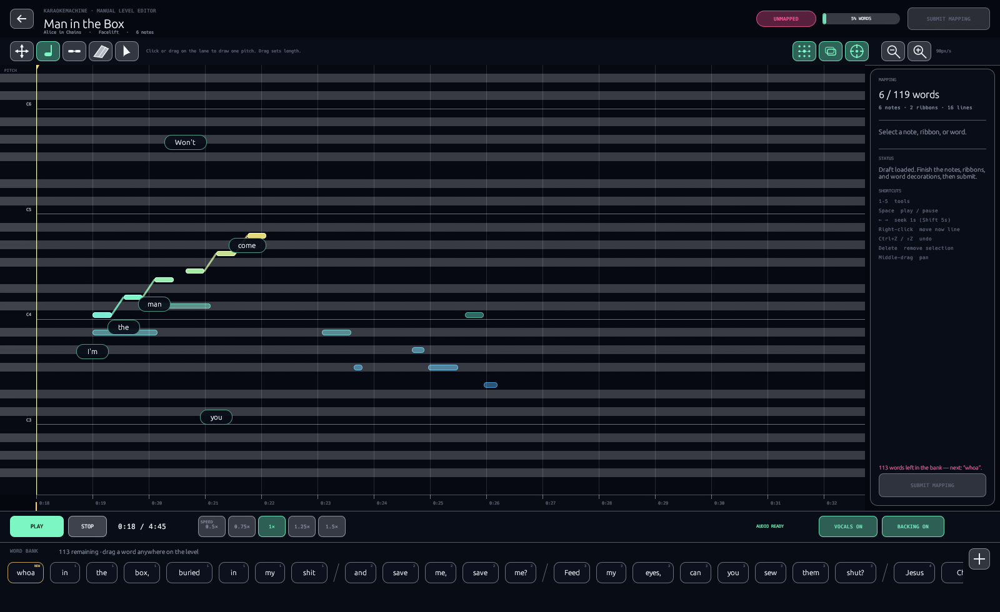
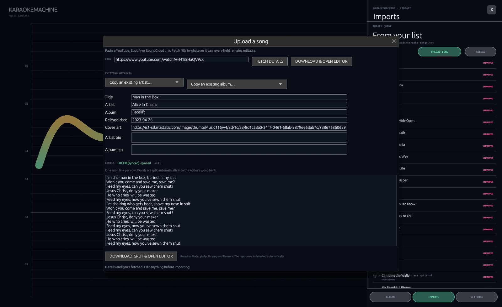
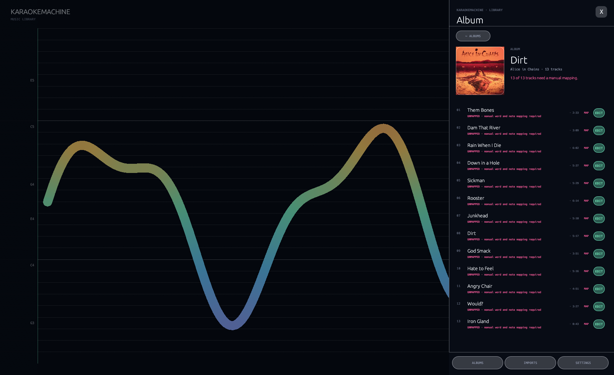

# KaraokeMachine

**A karaoke level editor first, a singing coach second.**

KaraokeMachine is a native Rust/egui desktop app for building karaoke levels by hand.
Every song starts as **UNMAPPED** and cannot be played until a human has drawn the vocal
notes and placed every lyric word in the level editor. The old automatic chart is kept
only as a translucent suggestion behind your work.





## What it does

- **Manual level editor.** Draw notes, resize them, connect them into word ribbons, erase
  them, select and move them, drag words out of a chronological word bank, scroll and
  zoom the timeline, and preview at variable speed. The raw suggested vocal notes remain
  visible in the background.
- **Submission gate.** A mapping is only accepted once every lyric word has been placed
  and at least one note exists. Submitted songs become playable; unfinished work is saved
  as a draft and stays UNMAPPED.
- **Word-level ribbons.** Each word is a rounded capsule or a connected run of capsules.
  Words are split automatically from the lyrics, and a word disappears from the bank once
  it is placed.
- **Upload and import.** Paste a YouTube, Spotify or SoundCloud link, fetch editable
  metadata and lyrics, choose an existing artist/album or fill in new ones, then download,
  split the backing and vocal stems, and open the editor automatically.
- **Native singing stage.** Pitch scoring, combos, per-song vertical fit, a mic-device
  picker, backing/vocal toggles, a vocal-range test, octave-aware scoring, and an
  **OCTAVE** cap when you sing the right note in the wrong octave.
- **Albums and warm-ups.** Album covers, release dates, track ordering, imported-song
  queue, and six built-in warm-up tracks.

## Why everything is UNMAPPED

Automatic vocal transcription is good at finding *a* melody, but it is not good enough to
be a karaoke level. It doubles guitar lines, misses quiet syllables, and puts words on the
wrong notes. KaraokeMachine therefore treats the automatic analysis as **suggestions only**:

- `notes`: the manual mapping that the singing stage uses.
- `suggestedNotes`: the old automatic chart, drawn translucently in the editor.
- `draftNotes`: unfinished manual work.
- `mapped`: false until **Submit Mapping** succeeds.

All existing songs in a library start with `mapped: false`. Clicking one opens the editor
instead of the stage.

## Editor controls

| Action | Control |
| --- | --- |
| Pan | `PAN` tool, or middle-drag from any tool |
| Draw a note | `NOTE` tool: click or drag on a lane; pitch stays fixed, drag sets length |
| Make a ribbon | `RIBBON` tool: drag across notes, then drop one word on the selection |
| Erase | `ERASER` tool: click or sweep over notes |
| Select / move / resize | `SELECT` tool: drag the body to move, drag either end to resize |
| Place a lyric word | Drag it from the word bank onto a note or ribbon selection |
| Scroll timeline | Mouse wheel |
| Zoom | Ctrl + wheel, or the `−` / `+` buttons |
| Play / pause | `Space` |
| Seek | Arrow keys, or click/drag the time ruler |
| Undo / redo | `Ctrl+Z` / `Ctrl+Shift+Z` or `Ctrl+Y` |
| Select tool | Keys `1`–`5` |
| Delete selection | `Delete` / `Backspace` |
| Leave editor | `Esc` or `← LIBRARY` (saves a draft for unmapped songs) |

The editor's speed buttons (0.5×–1.5×) are a **varispeed preview** for timing work; they
change pitch with speed. They are not a pitch-preserving transpose.

## Singing stage controls

| Action | Key |
| --- | --- |
| Play / pause | `Space` |
| Restart | `R` |
| Lyrics on/off | `L` |
| Original vocals on/off | `V` |
| Backing track on/off | `B` |
| Open library | `Esc` |
| Seek back/forward 5 s | `←` / `→` |
| Seek | Click the timeline |

Settings also contains the microphone picker, input gain, vocal-range test, octave shift,
and **Fit current song to my range**.

## Run it

Prerequisites for the desktop app:

- Rust stable with Cargo
- Linux desktop with X11/Wayland and a working OpenGL driver (or Windows)
- Node.js 22+ and the TypeScript tools for the import pipeline
- `ffmpeg`, `yt-dlp`, and Python 3 with **Demucs** for uploads

```bash
git clone https://github.com/rgbeans/karaokemachine
cd karaokemachine
npm install
npm run assets
cargo build --release --manifest-path rust/Cargo.toml
./launch.sh
```

For development:

```bash
cargo run --release --manifest-path rust/Cargo.toml
```

If a GPU driver misbehaves, force Mesa software GL:

```bash
KARAOKEMACHINE_SOFTWARE_GL=1 ./launch.sh
```

### Import dependencies

The app looks for `.venv/bin/yt-dlp` and `.venv/bin/demucs` first, then falls back to
commands on `PATH`. A typical setup is:

```bash
python3 -m venv .venv
.venv/bin/pip install -U demucs yt-dlp
# ffmpeg must also be installed system-wide
```

The upload form accepts:

- YouTube video links
- SoundCloud track links
- Spotify track links (resolved through Spotify oEmbed + a YouTube audio match)

Spotify's audio is DRM-protected, so the app uses Spotify for titles/artist/artwork and
finds a matching public audio source for the stems. Every metadata field remains editable.

## Import pipeline

1. Resolve the link to a downloadable audio URL.
2. Download audio with `yt-dlp`.
3. Separate vocals and backing with Demucs (`--two-stems=vocals`).
4. Normalize and encode 192 kbps backing and 160 kbps guide MP3s.
5. Trace the vocal melody for the translucent editor suggestions.
6. Fetch lyrics from LRCLIB, lyrics.ovh, or a Genius fallback; the user can edit them.
7. Fetch album metadata and artwork from iTunes, or accept a custom cover URL/file.
8. Write the song with `mapped: false`, empty `notes`, and the automatic chart in
   `suggestedNotes`.
9. Open the level editor automatically.

## Repository and media

The public repository contains the application, tools, documentation and the six
generated warm-up tracks. It **does not** contain the copyrighted commercial recordings
used during development. Commercial tracks under `assets/songs/*` are gitignored; use the
upload flow or place licensed audio in your local library.

Two useful paths:

```text
assets/songs/            local library (commercial imports are not committed)
dist-windows/            Windows package output (not committed)
```

## Windows package

The Windows build is made only when you run the script:

```bash
# prerequisites: rustup target add x86_64-pc-windows-gnu, mingw-w64, zip, rsync
./scripts/build-windows.sh
```

It cross-compiles `karaokemachine.exe`, stages the current `assets/` folder, and writes:

```text
dist-windows/KaraokeMachine-Windows-x64.zip
```

The script prints the zip size and SHA-256. It does not upload anything. The portable
build requires Node, ffmpeg, yt-dlp and Demucs for **new uploads**; mapping existing songs
in the bundled library does not require them.

## Project layout

```text
rust/
  src/main.rs          native entry point
  src/app.rs           library, stage, settings, upload form
  src/editor.rs        manual level editor, word bank, submission gate
  src/audio.rs         cpal output/mic, symphonia decoding, varispeed playback
  src/pitch.rs         native YIN pitch detector
  src/library.rs       song scan, albums, settings, scores
  src/model.rs         song, notes, lyrics, mappings and settings
tools/
  analyze_vocals.py    suggested-melody extraction
  clean_charts.py      legacy suggestion cleanup
src/main/              TypeScript import pipeline (download, Demucs, lyrics, metadata)
scripts/               tooling, warm-up generation, Windows packaging
packaging/             Windows README copied into the portable zip
docs/                  screenshots
```

The desktop runtime is Rust only. The TypeScript under `src/` is the offline/import
toolchain invoked by the upload form.

## Known limits

- A mapping is only as good as the time you put into it. Suggestions can be wrong; the
  editor is designed for correcting them by hand.
- The editor speed control changes pitch. Pitch-preserving time-stretch is not implemented.
- Spotify imports need a public YouTube/SoundCloud audio match. If none is found, use a
  YouTube or SoundCloud link for that track.
- Successful lyric lookup depends on LRCLIB/lyrics.ovh/Genius coverage. If lyrics are
  missing, paste or edit them in the upload form.
- Headphones give the cleanest score; speaker bleed can register as pitch.
- The Windows build is unsigned, so SmartScreen may show a warning.

## License

MIT.
